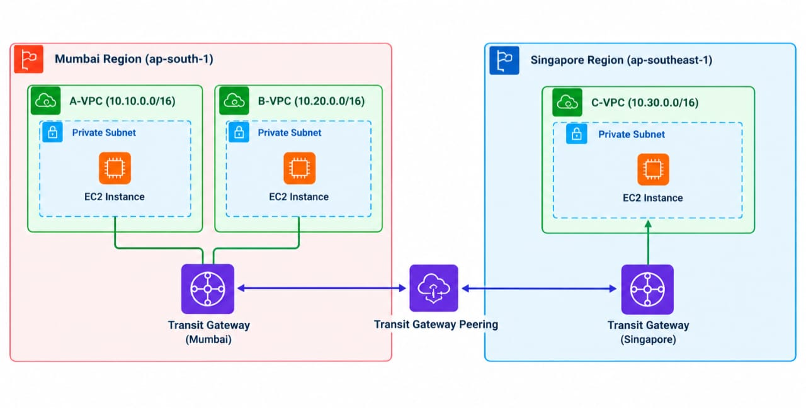

AWS Transit Gateway – Cross-Region VPC Connectivity

Project Overview

This mini project demonstrates private network connectivity between VPCs across two AWS Regions using AWS Transit Gateway and inter-Region peering.

Architecture

Mumbai Region ("ap-south-1")

- A-VPC: "10.10.0.0/16"
- B-VPC: "10.20.0.0/16"

Singapore Region ("ap-southeast-1")

- C-VPC: "10.30.0.0/16"

An EC2 instance was launched in a private subnet in each VPC. The VPCs were connected to their regional Transit Gateways, and the two Transit Gateways were connected using inter-Region peering.

AWS Services Used

- Amazon VPC
- Amazon EC2
- AWS Transit Gateway
- Transit Gateway Peering
- VPC Route Tables
- Security Groups and Network ACLs

Implementation Steps

1. Created three VPCs across the Mumbai and Singapore Regions.
2. Launched EC2 instances in private subnets.
3. Created Transit Gateways and attached the VPCs.
4. Established cross-Region Transit Gateway peering.
5. Configured static routes in the Transit Gateway route tables.
6. Updated VPC subnet route tables to route traffic through the Transit Gateways.
7. Tested connectivity between EC2 instances using their private IP addresses.

Connectivity Testing

Successfully tested private IP connectivity between EC2 instances in Mumbai and Singapore using the "ping" command.

Key Learnings

- Cross-Region Transit Gateway peering.
- Transit Gateway attachments and route tables.
- VPC routing and private network connectivity.
- Troubleshooting connectivity using ICMP ping.

Screenshots

Project screenshots are included in this repository as evidence of the VPC configuration, Transit Gateway attachments, route tables, and successful connectivity tests.

Outcome

Successfully demonstrated cross-Region private network connectivity between VPCs in Mumbai and Singapore using AWS Transit Gateway.

## Architecture Diagram

